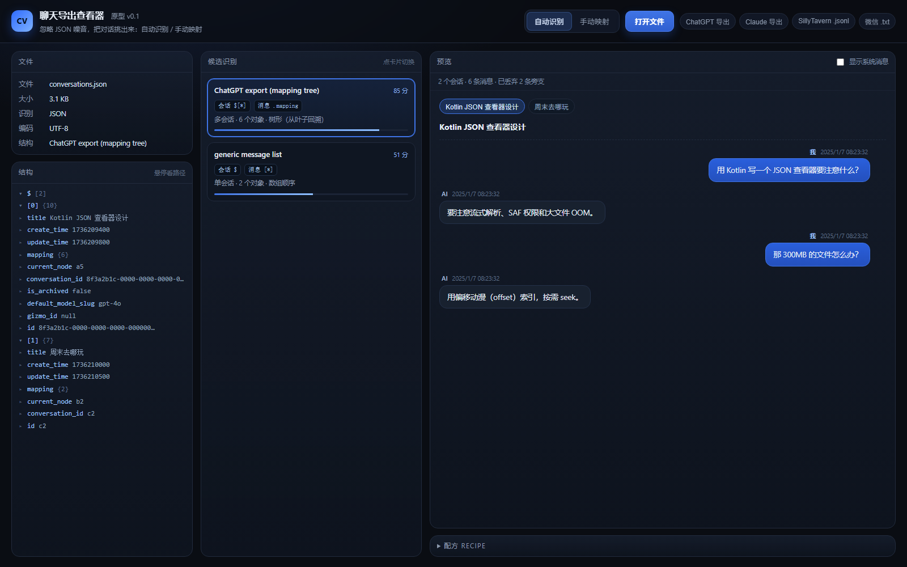
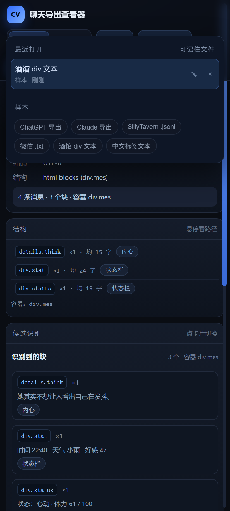

# Chat Export Viewer

Read chat exports (`json`, `jsonl`, `txt`, `.zip`, or files with **no extension at all**) as a conversation you
can scroll and search — ChatGPT, Claude, SillyTavern. Runs fully offline on your phone: no account, no upload,
not even the `INTERNET` permission.

Exporting a chat usually ends with a `conversations.json` nobody opens again — tree-shaped `mapping`,
dozens of metadata fields, nested `parts`. This tool hides that noise and keeps only "who said what",
folding things like `<div class="status">` or `【status】` into collapsible blocks.

| Desktop | Phone |
| --- | --- |
|  |  |

## Install

Android 8.0+, sideload this: **[Download chat-viewer-1.1.1-debug.apk](https://github.com/Yunmoli1/chat-export-viewer/releases/latest/download/chat-viewer-1.1.1-debug.apk)**
(1.1.1, self-signed, ~69 KB, `com.dsh.chatviewer`). Check the manifest: there is **no `INTERNET` permission**,
and `allowBackup` is off, so the recent-files list never leaves the device via cloud backup. WebView remote
debugging is compiled out of release builds, and WebView cannot read `file://` / `content://` — a file is only
read by the native layer after you pick it yourself.

No app needed either — open `prototype/index.html` in a browser (`file://` works, no server).

## What it does

- **Detects by content, not by filename.** Magic-byte sniffing (ZIP/PNG/JPEG/PDF/GZIP/SQLite are rejected
  with an explanation), encoding fallback UTF-8 → UTF-16 BOM → GB18030, then structure scoring for
  JSON / JSONL / chat txt, then semantics: find the collection where ≥60% of members are objects carrying
  both a role field and a text field.
- **Restores ChatGPT trees correctly.** `mapping` is a graph; walking it naively resurrects edited-away
  branches. It walks back from `current_node` via `parent`, reverses, and counts the discarded siblings.
- **Opens ZIP exports directly.** It reads the central directory itself, handles stored/deflate, ZIP64 and
  GBK filenames, scores entries by name and content to find the chat file, merges `conversations-000.json`
  shards, and falls back to a pickable file list with a "looks like chat" filter. Encrypted entries are
  explained, not guessed at. Each entry is capped at 64 MB of output (zip-bomb guard) and checked against
  its CRC32, so a corrupt archive says so instead of showing garbage.
- **Full-text search across every conversation**: hit list with "conversation · excerpt", click to jump
  and flash the message, Enter to cycle, multi-word AND. Substring scan, no index — instant for the
  file sizes the app accepts. On narrow screens the header grows a "Search" button that scrolls to the
  preview column and focuses the box (the single-column layout puts it far down the page).
- **Folds inline decorations** (status / inner thoughts / summary / OOC / choices) into collapsible,
  colour-coded blocks, classified with bilingual keyword tables plus `class` names and CJK pseudo-tags.
- **You decide the sides.** Per-role (me / AI / system / other) and per-block alignment, shared between
  auto and manual mode, persisted.
- **A draggable reading rail**: drag the thumb, click the track, or use the keyboard; tooltip shows
  "42% · message 17/86". On phones it pins to the right edge while the page scrolls.
- **Remembers your files**: SAF URI on Android, File System Access handle in Chrome/Edge, byte cache in
  IndexedDB elsewhere — with a graceful fallback message when the original is gone.
- **Manual mapping when the guess is wrong**: click through detected structural signatures, assign roles
  and text, and get a declarative recipe (`detect` / `locate` / `extract` / `assemble` / `display`) you can
  copy or download and reuse on exports with the same shape.

## Limitations

- The web version parses everything in memory; the Android shell caps a single file at 16 MB.
- ZIP is read-only: encrypted entries need a password (unsupported), nested zips are only pointed out,
  entries over 48 MB are not auto-read, and one entry stops at 64 MB of decompressed output.
  No PDF/image export, no CSV. Search is a substring scan.
- HTML exports are parsed heuristically by tags and class names, not a real DOM.
- Self-signed; not a store release.

## Build from source

The web version needs no build — open `prototype/index.html`.

The APK needs Node 22+, JDK 11+ and an Android SDK:

```powershell
npm run apk
```

Artifacts land in `android/build/` and a copy in `dist/`; the script then runs `apksigner verify` and
`aapt2 dump badging` as a self-check.

**Signing**: the key lives in `android/keystore/` (not committed; a PKCS12 / RSA 2048 key is generated on the
first build and reused afterwards, so same-package upgrades do not get rejected). To use your own key or a
different apksigner:

```powershell
$env:CV_KEYSTORE      = 'D:\keys\my-release.jks'
$env:CV_KEYSTORE_PASS = '...'
$env:CV_KEY_ALIAS     = 'myalias'
$env:CV_APKSIGNER     = 'D:\tools\apksigner\apksigner.bat'
npm run apk
```

Lose the key and phones with an older version installed cannot take an update — back it up.

## License

MIT — see [LICENSE](LICENSE). Provided as-is, but it cannot phone home: there is no network permission.
