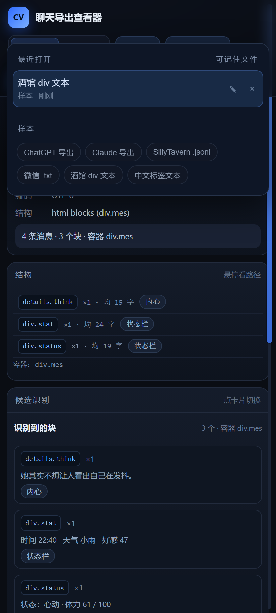
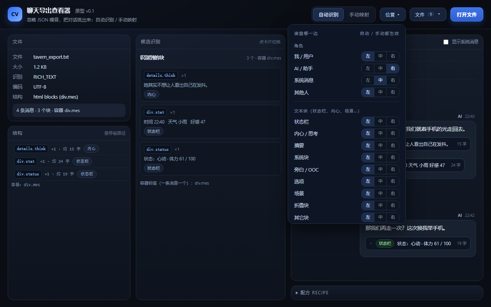
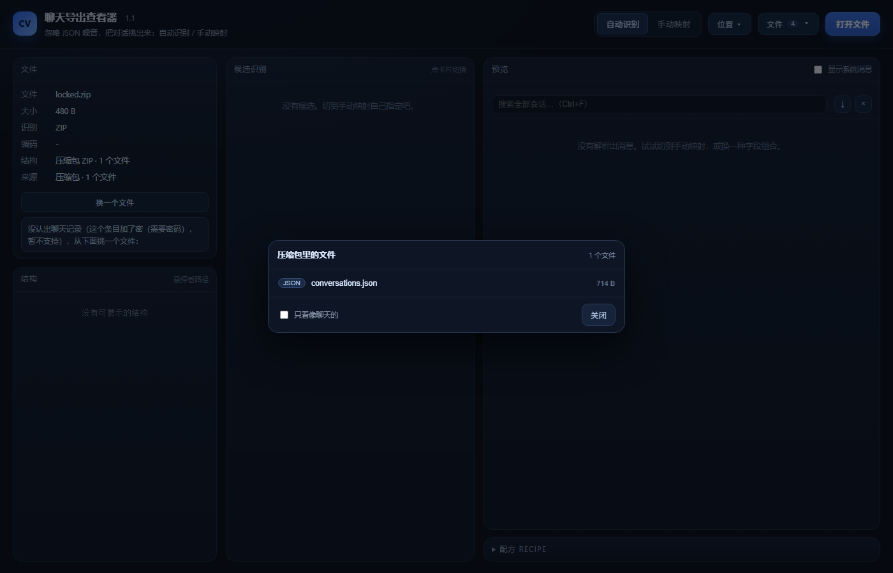
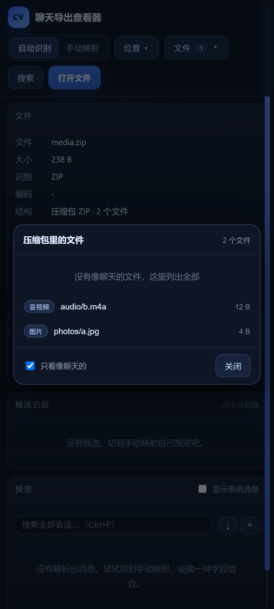
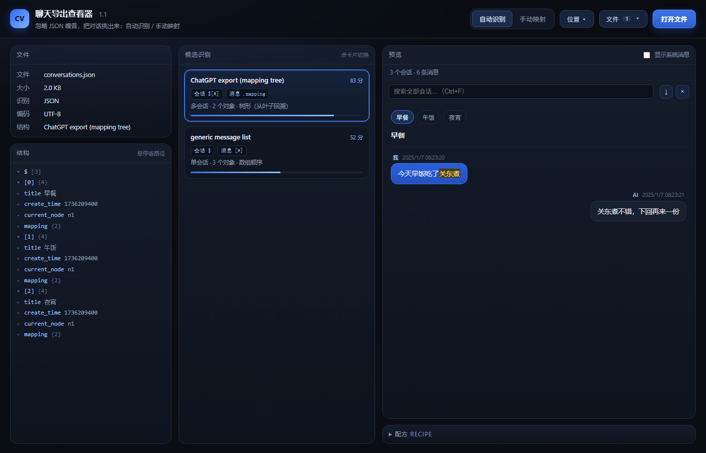

# 聊天导出查看器 · Chat Export Viewer

把各种聊天记录导出文件（json / jsonl / txt / 无后缀文件 / zip）读成**能滑、能搜的对话**：ChatGPT、Claude、酒馆（SillyTavern）导出的都行，手机上一键打开，离线、不联网、不上传。

很多人把对话导出成 `conversations.json` 之后就没再打开过 —— 树形的 `mapping`、几十个字段的
元数据、层层嵌套的 `parts`，用文本编辑器看是一坨噪声。这个工具把这些噪声挡在外面，
只留下「谁说了什么」，顺带把 `<div class="status">`、`【状态】` 这类夹在正文里的东西收成可展开的小块。

| 桌面（自动识别） | 手机 |
| --- | --- |
|  |  |

## 下载安装

Android 8.0 以上，直接装：

**[下载 chat-viewer-1.1-debug.apk](https://github.com/Yunmoli1/chat-export-viewer/releases/latest/download/chat-viewer-1.1-debug.apk)**

- 版本 1.1，包名 `com.dsh.chatviewer`，自签名，约 69 KB。
- **清单里没有 `INTERNET` 权限** —— 装完可以在系统设置里核对：它没有联网能力。
- 也关掉了 `allowBackup`，最近文件记录不会被系统云备份带走。
- 第一次安装需要允许「安装未知来源应用」。

不想装 App 也行：双击 `prototype/index.html`，浏览器里跑同一套代码（file:// 即可，无需服务器）。

## 它能干什么

### 1. 不认识的文件名也能读

导出文件经常没有扩展名（`conversations` 就是一个 4.7 MB 的裸 json），或者明明是 json 却叫 `.dat`。
所以识别**不看文件名、不看 MIME**，只看内容：

| 层 | 做的事 |
| --- | --- |
| 字节层 | 魔数嗅探：ZIP 直接打开浏览（stored / deflate / ZIP64 / GBK 文件名）；PNG / JPEG / PDF / GZIP / SQLite 拦下并说明；其余含 NUL 的文件按二进制处理 |
| 编码层 | UTF-8 → UTF-16 BOM → GB18030 依次回退，中文导出不乱码 |
| 结构层 | JSON、JSONL、聊天 txt（WhatsApp / 微信 / 方括号时间 / `名字:`），按打分选最像的 |
| 语义层 | 找「≥60% 成员是对象，且同时有角色字段和正文字段」的集合，命中就是消息列表 |

### 2. ChatGPT 的树形导出能正确还原

ChatGPT 的 `mapping` 是一张有向图，不是列表 —— 直接遍历会把「编辑过的旧分支」和「重新生成的前几版」
一起打出来，看起来像重复。这里从 `current_node` 沿 `parent` 回溯到根再反转，只走当前这条线，
旁支计数后丢掉（提示「已丢弃 N 条旁支」）。Claude 的 `parent_message_uuid` 同理。

### 3. 正文里的小块收起来，不打扰阅读

酒馆（SillyTavern）导出、半 HTML 记录里常有这种结构：

```html
<div class="status">时间：22:00 | 地点：公寓</div>
<div class="thoughts">（其实他有点紧张）</div>
```

它们会被切出来、按类别（状态栏 / 内心 / 摘要 / 系统 / 旁白 / 选项 / 场景 / 折叠块）配色，
渲染成折叠块插回原来的位置，默认收起。分类是双语词表 + class 名 + 中文伪标签（`【状态】`、`（旁白）`）一起判断的。

### 4. 左右谁说话，自己摆

顶栏「位置 ▾」里可以改：我 / AI / 系统 / 其他人各自靠左、居中还是靠右；
状态栏、内心这些**块**也能单独指定左右（或跟随所在气泡）。自动模式和手动模式共用同一套设置，
存 localStorage，也写进配方，重开还记得。



### 5. 侧边滑轨：能拖的进度条

手机上整页滚很长时原生滚动条几乎抓不住。右侧那条竖线是真进度条：拖滑块、点轨道、键盘
↑↓ / PgUp PgDn / Home End，悬停显示「42% · 第 17/86 条」。桌面贴面板内，手机贴视口右侧。


### 6. 记得住上次打开的文件

顶栏「文件 N ▾」是最近文件列表：点行切换、✎ 改显示名、× 移除。记住路径的能力按环境降级 ——

| 环境 | 记住什么 | 下次冷启动 |
| --- | --- | --- |
| Android App | SAF 的 `content://` URI（持久化读权限） | 直接读原文件 |
| Chrome / Edge | File System Access 句柄 | 请求一次权限后读原文件 |
| 其它浏览器 | 文件字节缓存（IndexedDB） | 用缓存打开 |

文件被删了、权限被回收了，会先用缓存顶上并提示，不会静悄悄失败。

### 7. 压缩包直接看，不用先解压

ChatGPT 的导出常常是一个 zip，里面 `conversations.json`、附件目录、README 混在一起。
现在直接把 zip 拖进来（手机上直接选）就行：

- 自己读中央目录，不依赖 `DecompressionStream`（老 WebView 也有纯 JS inflate 兜底），
  支持 stored / deflate、ZIP64、GBK 文件名。
- 自动猜哪个文件像聊天记录：按名字（conversation / message / chat / 聊天 / 记录）、内容
  （开头是 `[` `{`）、体积打分，最多试 6 个，跳过 48MB 以上的附件。
- 分片导出（`conversations-000.json`、`-001` …）自动按序号合并。
- 猜不出来就把包里的文件列出来，带「只看像聊天的」过滤，点哪行读哪个；加密条目会说明需要密码。

| 桌面 | 手机 |
| --- | --- |
|  |  |

### 8. 全文搜索

顶栏搜索框（Ctrl / Cmd + F）搜所有会话：命中列表带「会话名 · 那一条的摘录」，点一条直接跳到
对应消息并高亮闪一下；Enter / ↑ 在命中之间绕圈，Shift+Enter 反向，Esc 清空。多词是 AND。

手机上单列长页，预览在最下面，所以窄屏顶栏会多出一个「搜索」按钮：点它直接滚到预览并聚焦输入框，
不用自己一路滑下去找。



搜索是逐条子串扫描、不建索引 —— 16MB 以内即时，更大的文件等流式方案。

## 识别不准怎么办：手动映射

自动识别只是**猜**，猜错了就切「手动」：左栏列出识别到的每个结构签名（×次数 + 首行样本），
给它选类别（角色 / 正文 / 时间 / 状态栏 / 忽略……），中栏填会话与消息的路径，右栏实时重排。

改完的东西会生成一段声明式配方 JSON（`detect` / `locate` / `extract` / `assemble` / `display` 五段），
可以复制、下载，将来 Android 端按指纹复用同一份配方 —— 这是这个工具想过做成产品时留下的口子。

## 仓库结构

```
.
├─ prototype/          网页原型：解析引擎 + 界面 + 验证脚本（这是主体）
│  ├─ core.js          JSON 侧识别与装配（无 DOM，Node 可直接 require）
│  ├─ zip.js           ZIP 读取器（中央目录 / inflate / ZIP64 / GBK 文件名）
│  ├─ textblocks.js    文本 / 半 HTML 的块解析（无 DOM，UMD）
│  ├─ app.js           渲染与交互
│  ├─ scrubber.js      阅读滑轨
│  ├─ recents.js       最近文件（localStorage + IndexedDB，三档降级）
│  ├─ serve.js         本地静态服务器（npm run serve）
│  ├─ test.js          36 条纯逻辑断言
│  ├─ test-text.js     38 条块解析断言
│  ├─ test-zip.js      12 条 ZIP 断言（含 ZIP64 / GBK / 加密 / 截断）
│  ├─ zipmake.js       测试用造包器（不进 APK）
│  ├─ harness.js       验证用的 CDP 脚手架（自己拉起 headless 浏览器）
│  └─ verify-*.js      端到端验证：UI / 文本 / 文件 / 窄屏 / 左右 / 滑轨 / 弹层 / 原生桥 / 压缩包 / 搜索
├─ android/            把上面这套装进 WebView 的壳，一条命令出 APK
├─ sniffer/            Java 版的字节嗅探原型（识别逻辑的实验田，不参与打包）
├─ docs/               设计文档与截图
└─ dist/              打包好的 APK
```

## 开发

只需要 Node 22+（`fetch` / `WebSocket` 是全局的，没有依赖，不用装包）。

```bash
npm run lint      # 仓库约定：脚本 BOM、无 INTERNET 权限、三处版本号一致
npm test          # 纯逻辑断言（86 条）
npm run serve     # http://127.0.0.1:8765 打开原型
npm run verify    # 端到端：自动拉起 headless Edge/Chrome 跑 10 组检查并截图
npm run apk       # 构建 APK（需要 Android SDK，见下）
```

`npm run verify` 会找系统里的 Edge / Chrome（Windows 常见路径、Linux/macOS 常见路径），
找不到就设环境变量 `CV_BROWSER` 指向可执行文件。每组验证都会自己开一个临时浏览器配置，
互不干扰，跑完自动清理。`npm run serve` 默认 8765 端口，被占用时用 `PORT=9000 npm run serve` 换。

推上去后 GitHub Actions 会跑 `npm test` 并检查 `samples.js` 是确定性产物（重跑无 diff）。

### 构建 APK

不需要 Gradle，直接用 SDK 里的 `aapt2` / `javac` / `d8` / `zipalign` / `apksigner`：

```powershell
# 需要：JDK 11+、Android SDK（build-tools + platforms/android-34 以上）
# SDK 位置按 ANDROID_HOME → ANDROID_SDK_ROOT → 常见安装路径 依次找
npm run apk
```

产物 `android/build/chat-viewer-debug.apk`，并复制一份到 `dist/`。脚本末尾自动跑
`apksigner verify` 和 `aapt2 dump badging` 自检。

签名密钥放在 `android/keystore/`（`.gitignore` 挡住，不进仓库；第一次构建自动生成，之后一直复用）。
要换成自己的正式密钥或换个 apksigner，用 `CV_KEYSTORE` / `CV_KEYSTORE_PASS` / `CV_KEY_ALIAS` / `CV_APKSIGNER` 覆盖，
详见 [android/README.md](android/README.md#签名)。

两个 Windows 上的坑（脚本里已经绕开，改脚本时别踩回去）：

- `aapt2` 在**非 ASCII 路径**下会报 `系统找不到指定的文件 (2)`（`-A` 目录枚举失败，与文件是否存在无关）。
  所以脚本先把工程拷到系统临时目录里的 ASCII 路径构建，最后只把 APK 拷回来。
- PowerShell 5 读**无 BOM 的 UTF-8 脚本**会按 ANSI 解码，中文注释直接让脚本解析崩。
  `android/build-apk.ps1` 必须存成 UTF-8 **带 BOM**（`.editorconfig` 里已经声明）。

## 已知限制

- **网页版是全量解析**，大文件（>100 MB）会卡；Android 版单文件上限 16 MB（base64 过桥 + 一次性入内存）。
  设计里写好的两遍流式扫描 + 分段落盘还没实现，见 [docs/design-architecture.md](docs/design-architecture.md)。
- ZIP 只读不写：加密条目需要密码（暂不支持），套娃压缩包只提示不解开，包里 >48MB 的条目不会被自动读。
- 没有 PDF / 图片导出、CSV；全文搜索是子串扫描，没有索引。
- HTML 导出只按标签 + class 名做启发式解析，没有真正的 DOM 解析，复杂模板可能分错块。
- 只做过 Windows 上的构建与验证；macOS / Linux 上应该能跑（脚本是 Node 的），但没实测。
- 自签名（密钥在本地，不进仓库），不是商店版本；包名、图标、文案都是最小的可用状态。

## 设计文档

- [架构与市场盘点](docs/design-architecture.md) —— 三层架构、树形还原、大文件流式、商业化与风险
- [双模式映射](docs/design-dual-mode.md) —— 自动识别与手动映射怎么共用一套配方
- [无后缀与文本文件识别](docs/appendix-file-format-detection.md) —— 魔数表、编码判定、聊天行规则、ZIP 分片
- [网页原型说明](prototype/README.md) · [Android 壳说明](android/README.md) · [Java 嗅探原型](sniffer/README.md)

## 许可

MIT，见 [LICENSE](LICENSE)。版权行写的是 `chat-export-viewer contributors`，要署自己的名字/ID 直接改那一行即可。

这是个人小工具，按「现状」提供，不承诺兼容性也不对你的数据负责 —— 但请放心，它连网都上不了，
导入的文件只留在你自己的设备上。
